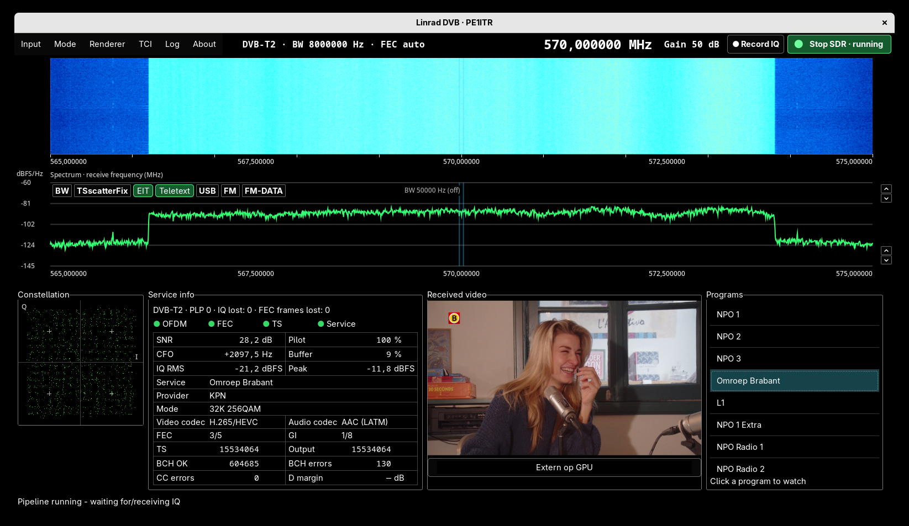

# Linrad DVB

An SDR receiver for **DVB-S, DVB-S2, narrowband DVB-T, 8 MHz DVB-T2 and DAB/DAB+**,
with a GTK interface for spectrum, waterfall, constellation, decoder status
and television playback, for amateur DATV, weak-signal DX and broadcast reception.

Linrad DVB is developed by **Rob Hardenberg / PE1ITR**. His work includes
the application and user interface, direct SDR control, the DVB-T receiver,
the DAB/DAB+ receiver developed from his dab-monitor project, TSscatterFix,
and the experimental DVB-T bonding library and receiver merger.
He also integrates and extends the upstream DVB-S/S2 and DVB-T2 decoders,
with receiver recovery fixes, CPU and GPU optimizations, telemetry and
Windows support. The origins of those decoder cores remain credited below.

The name comes from the project's beginnings as an add-on to
[Linrad](https://www.sm5bsz.com/linuxdsp/linrad.htm), the SDR receiver by
Leif Åsbrink / SM5BSZ. Linrad initially served as the SDR frontend: it
controlled the radio hardware and sent IQ samples over the network to
linrad_dvb for decoding. The project has since grown into a standalone
receiver with direct SDR support. Rob has retained the name both as a link
to those beginnings and out of personal appreciation for Linrad, a program
he enjoys using. Linrad UDP input remains supported.
The AFEDRI network control follows the AFEDRI protocol and Linrad's
implementation; the signal meter also takes inspiration from Linrad.

| Component | Origin | Development by Rob Hardenberg / PE1ITR |
| --- | --- | --- |
| Application | Rob Hardenberg / PE1ITR | Interface, hardware control and receiver integration |
| DVB-T | [rbdvbt](components/dvbt/README.md) · PE1ITR | Receiver development and integration |
| DVB-T2 | [OnAir](https://github.com/adswill/OnAir) · adswill and contributors | Integration, recovery fixes and CPU optimizations |
| DVB-T2 GPU LDPC | OnAir · Direct3D 11 and Vulkan | GPU integration and an optimized Vulkan kernel |
| DVB-S/S2 | [LeanSDR / LeanDVB](https://github.com/pabr/leansdr) · pabr | Integration, telemetry and FEC improvements |
| DVB-S2 CPU LDPC | Ahmet Inan / xdsopl, adapted by [pabr](https://github.com/pabr/xdsopl-LDPC-pabr) | SIMD selection, batching and worker management |
| DVB-S2 GPU LDPC | OnAir LDPC code, tables and Vulkan backend; locally optimized kernel | Optional S2 helper, soft-bit conversion, original-input CPU fallback/retry, tests and measurements |
| DVB-T bonding | [dvb-channel-bonding](components/bonding/README.md) · PE1ITR, component 1.6.0 | Bonding library, receiver merger, partner control and integration |
| DAB/DAB+ | [dab-monitor](components/dab/ORIGIN) · PE1ITR | Receiver, audio, data services and DX recovery |
| TSscatterFix | [TSscatterFix](components/tsscatterfix/README.md) · PE1ITR | Image recovery and application integration |

OnAir, by Kristijonas Adomaitis (adswill) and contributors, supplies the
complete DVB-T2 IQ-to-TS receiver core and the original GPU LDPC implementations.
This project integrates and extends that work. DVB-S/S2 reception uses
pabr's LeanSDR, including acquisition corrections by Ondřej OK1CDJ; the
separate LDPC helper originates with Ahmet Inan (xdsopl), adapted by pabr.
The P1 tables imported through OnAir also credit gr-dvbt2 by Ron Economos / W6RZ.
DAB uses OnAir's generic resampler, libsamplerate and FAAD2 for AAC audio.
The optional S2 GPU path reuses the OnAir-derived LDPC implementation; the S2
helper and CPU fallback are local additions. It is not a new independently
written LDPC decoder. Reference implementations and research influences are
listed separately in the [credits](docs/credits.md).

Bundled code retains its original author and license notices. See
[licenses and acknowledgements](docs/credits.md) for component licenses and
dependencies, and the [DVB-T2 provenance record](components/dvbt2/UPSTREAM.json)
for the imported OnAir revision and local changes.

Linux is the main development platform; a native Windows x64 package is also available, with the
[DVB-T2 performance limitations described below](#dvb-t2-on-windows).

This is the main development repository for **linrad_dvb**, the **DVB-T receiver
(rbdvbt)** and **TSscatterFix**, with DAB reception in its own [component](components/dab/README.md). Their source code, integration, tests and future
development are maintained together here.



*DVB-T2 reception at 570 MHz. Screenshot from an actual receive session.*

- [Purpose](#purpose)
- [Features](#features)
- [Weak-signal and DX reception](#weak-signal-and-dx-reception)
- [Buttons and everyday controls](#buttons-and-everyday-controls)
- [Tested computers and practical limits](#tested-computers-and-practical-limits)
- [Build and run](#build-and-run)

## Purpose

The main aim is to help amateur television DXers receive, identify and document
weak or intermittent stations. A short opening may yield a service name,
a few usable picture fragments or a DAB transmitter identification even when
continuous sound and video are not possible. The application brings those
observations, decoding controls and a reception log into one receiver window.

Linrad DVB turns raw radio samples (IQ) into digital television and DAB+ radio.
It tunes a supported SDR, or accepts samples from Linrad or an IQ recording.
For DVB, it synchronizes and decodes the signal into an MPEG transport stream. You can watch
the received programme in the same window while checking signal strength,
spectrum, constellation and decoder errors. In DAB mode, it identifies the
ensemble and services, plays a selected DAB+ station and displays transmitted
text and MOT slideshow images. DAB+ audio requires FAAD2 support; legacy
DAB/MP2 audio is not decoded.

Use DVB-S/S2 and narrowband DVB-T for amateur digital television and weak-signal
experiments; use DVB-T2 for supported 8 MHz broadcast multiplexes. You can also
save a reception, replay it later, or forward the decoded stream to another
player. TSscatterFix provides a separate image-recovery view for incomplete
receptions. A manual reception log records stations and confirmed DAB TII codes,
with editing and ADIF export. Your saved station locator also supports distance
and antenna-bearing calculations. A headless mode runs the receiver without
the graphical interface.

```text
SDR / Linrad UDP / IQ file -> DVB decoder -> television, recording or network output
                          -> DAB decoder -> DAB+ audio, text, slideshow and ensemble/TII info
```

## Videos

- [Watch video 1 on YouTube](https://youtu.be/F3bMFZxpWrI)
- [Watch video 2 on YouTube](https://youtu.be/3F3bCIXOU2w)

## Features

- Receive IQ from Linrad over UDP, a supported SDR, or a recorded IQ file.
- Live spectrum, waterfall, constellation and decoder status, with an adjustable
  IQ bandpass filter, receiver/converter offsets and PNG screenshots.
- DAB Band III or free-frequency tuning, clickable DAB+ stations, dynamic text,
  MOT slideshow, ensemble/country information and confirmed TII logging.
- Normal, weak-signal/DX and aircraft-scatter DAB profiles; optional B210 fixed-IF mixer support.
- Built-in DVB decoders, with parallel CPU LDPC for DVB-S2 and DVB-T2,
  optional experimental GPU LDPC for DVB-T2, and Linux GPU LDPC for PI6EHV DVB-S2.
- Experimental DVB-T bonding: detect two related 40 kHz channels in one IQ input
  and merge their MPEG-TS streams; shared and separate video/audio modes.
- Embedded VLC playback, service selection, EIT programme information and teletext.
- Switch live DVB video to external FFplay with NVIDIA CUDA decoding and Vulkan rendering.
- TSscatterFix image recovery from incomplete transport streams.
- IQ and MPEG-TS recording, IQ replay, UDP transport-stream output and SRT output.
- Parallel audio monitoring in USB, FM or FM-DATA, TCI and optional PCM UDP output.
- Editable CSV reception log: UTC time, RF frequency, service/provider, mode,
  decoder settings and DAB TII, with selected/all ADIF export as reception (SWL) records.
- My Station callsign/locator settings and a Maidenhead distance/bearing calculator.
- Headless operation and command-line pipeline inspection for automated receiver setups.

## Weak-signal and DX reception

These options serve different purposes: acquiring a signal, recovering usable
data during a short opening, inspecting reception quality, and recording the
result. A visible constellation alone does not mean the programme is decodable.

### DVB-S/S2: short openings and low symbol rates

**Mode** exposes the DVB-S2 error-correction method, worker count, acquisition
mode and processing mode. **Soft-decision LDPC** is the default; **Bit-flipping**
is also available. The automatic settings follow the selected symbol rate:

| DVB-S2 symbol rate | Automatic acquisition | Automatic LDPC processing |
| --- | --- | --- |
| Up to and including 333 ksym/s | Continuous search | Low latency: one frame at a time |
| Above 333 ksym/s | Normal search | Throughput: batches of up to 32 frames |

Continuous search keeps looking for frames after unsuccessful acquisition;
low latency avoids waiting for a batch during a short signal opening. The
default is one LDPC worker; 1–8 are selectable. More workers are not always
faster, and these DVB-S2 controls do not configure the DVB-T2 worker pool.
DVB-S uses continuous acquisition and high-quality processing by default.
See [decoder measurements](docs/decoders.md) for the weak-recording comparisons,
including the 125 ksym/s DL4FBN reception tests. They are evidence for those
signals, not a universal sensitivity gain in dB.

On Linux, **Mode → Use GPU for DVB-S2 LDPC (experimental)** optionally moves
LDPC for **8PSK 3/4 normal frames (MODCOD 14, PI6EHV)** to the GPU. It is off by
default, requires soft-decision LDPC and takes effect at the next reception
start. GPU selection uses one executor; the saved CPU worker selection is
retained for CPU mode. Other frame types, an unavailable/failed GPU and frames
without valid GPU parity use the production CPU decoder. BCH stays on CPU.
The log identifies the GPU and reports GPU/CPU frame counts. Windows S2 GPU
support is not enabled. GPU video playback is a separate choice.

In two original-rate replays of the same 49-second PI6EHV recording on Linux
Ryzen 7 5800H / RTX 3050, decoder-plus-helper CPU time fell from a median
**46.44 s to 21.43 s (54% less)** with byte-identical TS and BBFRAME output.
This frees about half a CPU core over that source duration; it does not mean
54% less load across the whole machine. The full unpaced chain was slower
with GPU initialization included: **14.54 s versus 12.71 s on CPU**. The GPU
uses FP32 normalized min-sum rather than the production CPU's int8 corrected
min-sum; matching data on this recording does not establish equal sensitivity
under all conditions. Live reception and simultaneous video playback require
separate validation. See the [measurements](benchmarks/dvbs2-gpu-2026-11-16.json)
and [investigation](docs/dvbs2-gpu-pi6ehv-investigation-20261109.txt).

**D margin**, in Service info for DVB-S/S2, estimates reception reserve from
MER and a modulation/FEC reference threshold. Red is below 0 dB, orange is
0–2 dB and green is at least 2 dB. It is an aid to tuning, not a calibrated
guarantee of picture or audio; unsupported or unavailable values show `—`.

### Experimental DVB-T bonding

The integrated receiver merger uses PE1ITR's **dvb-channel-bonding 1.6.0**
component. It discovers the partner channel from received announcements and
runs two DVB-T decoders on the same IQ input. The transmitter selects shared
transport with XOR protection or separate video/audio lanes; the receiver
recognizes the mode and merges the received streams before normal playback,
recording and network output. Separate lanes do not provide XOR repair.

**Mode → Disable automatic DVB-T bonding** keeps standalone reception active
while still detecting announcements; the Bonding indicator can then join
manually. The default recovery buffer is eight seconds. This is a local
experimental transport, not a claim of standardized DVB channel bonding or
guaranteed recovery. See [receiver operation and limitations](docs/dvbt-bonding.md)
and the [three recorded trials](docs/dvbt-bonding-drie-proeven-20261115.md).
The component is **GPL-3.0-only**, Copyright 2026 Rob Hardenberg / PE1ITR;
its [source record](components/bonding/ORIGIN) pins the licensing commit and
[LICENSE](components/bonding/LICENSE) contains the full terms.

### TSscatterFix: recovering pictures from incomplete reception

Enable **TSscatterFix** to reconstruct images from a parallel copy of the
received transport stream, particularly for repeated/static DATV test pictures.
Its recovery and candidate-ranking code can make fragments useful when the
normal video player cannot show a complete picture. The recovery panel shows
the result and estimated progress; **R** clears accumulated reconstruction.
It does not turn an incomplete reception into guaranteed continuous television.
The original stream to the player, recording and UDP output stays unchanged.
See the [TSscatterFix component](components/tsscatterfix/README.md).

### DAB: weak stations and aircraft scatter

Choose a profile under **Mode → DAB reception**:

| Profile | What it adds |
| --- | --- |
| **Normal** | Continuous DAB+ audio with independent ensemble/FIC and TII analysis. |
| **Weak signal / DX** | Extra phase-reference searches for timing/frequency/inversion and accumulation of CRC-validated identity fragments across captures. |
| **Aircraft scatter** | The weak/DX options plus temporal ranking and six overlapping 2.5-second analysis windows within each eight-second capture, to inspect short openings. |

The deeper DX analysis is separate from continuous audio decoding. It may
identify a station or transmitter without producing listenable audio; choosing
a DX profile does not apply all of its fallback processing to the audio path.
These profiles require more processing time. **Capture** is the progress of an
eight-second analysis capture, not receiver buffer occupancy.

**TII** lists transmitter codes, confidence and confirmation status. Confirmed
observations can be logged; ambiguous candidates remain identifiable as such.
See [DAB reception](#dab-reception) and the [DAB component](components/dab/README.md).

### Finding and preserving a weak signal

Use spectrum/waterfall and the signal-history meter to follow fading and short
openings. The **BW** IQ filter can suppress out-of-channel signals, but must
remain wide enough for the selected modulation. It cannot undo overload that
already happened in the radio. **USB**, **FM** and **FM-DATA** provide a separate
audio monitor while the digital receiver continues. **Record IQ** preserves a
reception for later replay; **P** captures the screen and **Log** records the
identified station. Compare fresh error-counter increments, not just lifetime
totals or the size of a constellation.

## Buttons and everyday controls

The top row selects the input, decoder and output. Controls in the spectrum
row open analysis tools or switch live functions. Mode-specific controls appear
only where applicable; hover over a control for its tooltip.

| Button or control | Function |
| --- | --- |
| **Input** | Select the SDR, Linrad UDP or an IQ file; configure sample rate, device arguments, gain-related options, tuning step and frequency offsets. Stop reception to change hardware settings. |
| **Receive frequency (MHz)** | Click the displayed frequency to enter a receive frequency in MHz while reception continues; press Enter or Tune. Accepts a decimal point or comma and includes configured frequency offsets. Direct SDR input only. DAB switches to Free frequency for values outside the channel list. |
| **Mode** | Select DVB-S/S2/T/T2 or DAB. Set symbol rate/channel bandwidth, modulation, FEC and guard interval where applicable; choose DVB-S2 acquisition/CPU/GPU LDPC, DVB-T bonding, DVB-T2 PLP/GPU LDPC, or DAB channel/profile. |
| **Renderer** | Choose embedded or external video, a TS file, UDP or SRT output; configure the additional UDP copy. |
| **Start SDR / Stop SDR** | Start or stop reception. The label changes for Linrad input and IQ-file playback. |
| **Record IQ** | Start/stop raw sample recording during live reception, with metadata for replay. This is different from saving decoded MPEG-TS through Renderer. |
| **BW** | Enable/bypass the IQ channel filter. The bracket keys adjust its width; DVB-T2 requires the full 8 MHz channel. |
| **TSscatterFix** | Enable/disable separate picture reconstruction during DVB reception and show/hide its panel. |
| **Programs / DAB station list** | Click a DVB programme to switch the embedded player, or a DAB+ station to switch audio. Programs occupies the reconstruction-panel position when TSscatterFix is off. External DVB players select their own programme. |
| **EIT** | Open received programme/event information. |
| **Teletext** | Open broadcast teletext; enter a page or use **Vorige**, **Volgende**, **Index (100)** and **Reveal**. Pages must be received before they can be displayed. |
| **TII** | In DAB, inspect transmitter IDs and log confirmed observations. Green indicates codes in the latest capture; **✓ Logged** marks an already logged ensemble/code combination. |
| **USB / FM / FM-DATA** | Toggle the parallel 3 kHz USB, 12.5 kHz FM or 20 kHz flat-audio FM-DATA monitor. Here USB means upper sideband. Only one monitor mode is active at a time. |
| **TCI** | Configure the monitor's TCI connection, audio output and optional PCM UDP stream. |
| **Log** beside FM-DATA | Capture the current service/ensemble in the reception editor; **Save reception** writes it to the log. |
| **Log** in the top menu | Open **RX log**, **My Station**, **Bearing**, **Application log** or **Status endpoint…**. |
| **Extern op GPU / Terug in venster** | Switch DVB playback between external NVIDIA FFplay and embedded VLC while reception continues. This accelerates video playback, not radio demodulation or LDPC. |
| **◀ / ▶** in DAB | Previous/next Band III channel, or the configured tuning step in Free frequency mode. |
| Spectrum/waterfall arrow buttons | Adjust the displayed noise-floor level and vertical range; these do not change SDR gain. |
| Signal-meter arrow buttons | Adjust level range, trace position and averaging/time scale. |
| **About** | Show version/build identity, credits and the keyboard reference. |

With the main receiver window focused:

| Key or action | Function |
| --- | --- |
| **← / →** | Tune a direct SDR; move through DAB channels, or tune by step in Free frequency mode. With Linrad input, tune in Linrad. |
| **↑ / ↓** | Increase/decrease SDR gain. HackRF shows and adjusts LNA/VGA separately according to the policy below. |
| **[ / ]** | Narrow/widen the IQ filter within the receive mode's limits. |
| **U / F / D** | Toggle USB / FM / FM-DATA monitoring. |
| Click the spectrum | Tune the active audio monitor to the clicked frequency. |
| **Page Up / Page Down** | Tune the audio monitor down/up: 100 Hz for USB, 2.5 kHz for FM/FM-DATA. |
| **M** | Mute/unmute speaker audio; TCI audio continues. |
| **R** | Reset TSscatterFix reconstruction. |
| **P** | Save a PNG screenshot of the whole main window. |
| **W** | Save receiver settings, including spectrum/waterfall settings. |
| **Alt+I / Alt+M / Alt+R / Alt+T / Alt+L / Alt+A** | Open Input / Mode / Renderer / TCI / Application log / About. |

For **HackRF**, the gain arrows first raise LNA from 0 to 40 dB in 8 dB
steps while VGA stays at 12 dB. Only then does VGA rise in 2 dB steps, up to
24 dB. **Input → RF amplifier (AMP)** independently offers Auto / Off / On;
Auto enables AMP when LNA reaches 40 dB. Older aggregate-gain configurations
start the new policy at LNA 32/VGA 12; **W** saves that migration. This avoids
the driver's earlier abrupt redistribution between LNA and VGA.

## Hardware inputs and receive modes

Input profiles cover HackRF One, USRP B210, RFspace SDR-IQ, AFEDRI Net,
RTL-SDR, FUNcube Pro+, LimeSDR Mini v1.2, SDRplay RSP1A/RSP1B, Airspy R2 and
Airspy HF+ Dual Port (VHF), and Pluto / PlutoSky RX1 via native libiio. Available receive modes depend on the device's
frequency range and sample rate; some integrations still need live hardware
validation. See [receiver setup and test status](docs/receivers.md).

The [native Windows package](docs/windows.md) includes DVB and DAB+ reception.
B210-compatible Kintex-7, HackRF and RTL-SDR have been used in native Windows
live checks; that does not validate every listed radio/driver combination.
Direct FUNcube Pro+, LimeSDR Mini and Pluto / PlutoSky RX1 are also implemented,
with their hardware-specific validation limits listed in the Windows notes.

DVB-T2 supports the implemented **8 MHz broadcast modes**, with 8–20 MS/s IQ
input; 10 MS/s is a starting point. A B210-compatible receiver was also tested
at 9,142,857 samples/s, close to the native 64/7 MHz DVB-T2 rate, while retaining
8 MHz channel bandwidth. The device must actually support the selected rate.
MISO, inter-frame time interleaving and type-2/sub-sliced PLPs are not supported.
DAB audio supports Mode I DAB+ with EEP-A/B protection; legacy DAB/MP2 and UEP
are not implemented. See [decoder details](docs/decoders.md), the
[DVB-T2 component](components/dvbt2/README.md) and [DAB limitations](components/dab/README.md).

## Tested computers and practical limits

These are development and reception observations as of **9 November 2026**,
not minimum system requirements or guarantees for every multiplex.

| Computer/platform | Testing performed | What the results establish |
| --- | --- | --- |
| **Linux x86-64, AMD Ryzen 7 5800H — 8 physical cores / 16 logical processors** | Main development/build machine; recorded-IQ DVB-S/S2/T/T2 tests, live 8 MHz DVB-T2 with B210-compatible Kintex-7 and HackRF, and live DAB+ with RTL-SDR/B210. | B210 live intervals sustained about 19,400 TS packets/s with very few bad blocks. HackRF also approached that throughput after the LNA-first gain change, though losses remained in its measured interval. |
| **Native Windows x64, AMD Ryzen 5 5500H — 4 physical cores / 8 logical processors** | Live DVB-T2 with B210-compatible Kintex-7 and HackRF; RTL-SDR DVB-T/DVB-S and DAB+, plus B210 DAB+. GPU video rendering was also tried. | DAB+ comparisons had intervals without measured audio/IQ losses. Heavy DVB-T2 reception remained variable, with hardware overflows, decoder/FEC losses or jerky playback in several runs. |

The Windows test computer has fewer physical cores than the Linux machine.
These runs therefore **do not isolate an operating-system performance difference**.
Sample rates, gain, worker settings, radio and RF conditions also differed;
no precise CPU-speed ratio or universal reception limit follows from them.

Windows executables also undergo software tests **under Wine on the Linux
5800H**. Those tests check correctness and integration; they are not native
Windows radio/performance measurements. The **ODROID-N2 / Ubuntu 20.04 aarch64**
build path has container/compiler/emulation checks, but full reception
throughput on a physical N2 is **not yet validated**. See the
[ODROID notes](docs/headless.md#odroid-n2-ubuntu-20046-aarch64-en-meerdere-rtl-sdrs).

### DVB-T2 on Windows

**8 MHz DVB-T2 is demanding, and smooth, loss-free reception is not yet
established on the tested Ryzen 5 5500H Windows system.** A constellation or
high SNR can coexist with damaged or missing data and interrupted video.
CPU remains the default for demodulation and LDPC/BCH error correction.
**Mode → Use GPU for DVB-T2 LDPC (experimental)** separately enables optional
Direct3D 11 LDPC with CPU fallback; signalling, demodulation and BCH remain on
CPU. This implementation does not establish loss-free native Windows
reception. **Extern op GPU** controls video playback independently. The Linux
DVB-S2 GPU option described above is not enabled on Windows.

The GPU renderer made the picture substantially more watchable in the user's
Windows tests. One measured interval reached about 18,800 TS packets/s with
no new decoder-IQ or FEC-frame drops, while SDR hardware-overflow indications
remained. Other intervals were worse. This is useful reception, but not proof
that the underlying sample-loss problem is solved. See the saved
[Windows reception baseline](benchmarks/dvbt2-sdr-receive-2026-11-09.json).

The tested B210 setup used its own board-specific FPGA/firmware images and
`type=b200`. Using 9,142,857 samples/s, the AVX2 clock-correction path and four
background FEC helpers improved some measured intervals. The
`DECT2_THREADS=4` setting means four helpers plus the participating PLP thread;
it is not a four-core CPU limit. These are tested configurations, not a
universal prescription. See [Windows setup and profiling](docs/windows.md).

Check fresh counters separately: SDR hardware overflows, SDR output-queue
drops, decoder `input_dropped` and `fec_frames_dropped` describe different
loss points. The DVB-T2 "bad BCH" total also includes blocks skipped by the
decoder's recovery policy, so it is not solely a count of attempted BCH failures.
More processing headroom can help, but the remaining Windows loss cause has
not been pinned down to CPU capacity, USB transport, a driver or a single bug.
Avoid running decoder benchmarks alongside a live receiver when comparing it.

## Playback and reception logging

For GPU video playback, select **Renderer → Embedded player** and click
**Extern op GPU** below **Received video** during reception. **Terug in venster**
or closing FFplay returns to embedded VLC while reception continues. This needs
FFplay with CUDA and Vulkan/libplacebo support; see the
[GPU player instructions](docs/usage.md#tijdens-ontvangst-overschakelen-naar-de-nvidia-speler).
DAB uses its own audio player and MOT slideshow.

Click **Log**, directly beside **FM-DATA**, while receiving to capture the current
digital service. Review the service and provider names (together identifying the
station), then click **Save reception**. The timestamp and tuning are captured
when the dialog opens. Nothing is logged automatically. The default file is `reception-log.csv`
beside the configuration file; override it with `[logging] file=/path/to/log.csv`.
Existing entries are preserved, and each saved entry is flushed and closed.
Frequency includes converter LO and digital receiver offset. With Linrad input,
check the manually configured frequency; it can be corrected in the log dialog.
IQ replay is marked `source=file`, with the current logging time.
The CSV `tii` field holds DAB transmitter identifiers and stays empty for DVB.
In DAB mode the main Log button captures the ensemble. Open **TII** in
the spectrum button row and use the **Log** button beside a confirmed code to capture that
transmitter, its ensemble, RF frequency and observation time. Candidates and
ambiguous codes remain visible but cannot be logged as confirmed detections.
The TII button turns green when the latest capture contains codes. The popup
aligns code, confidence, hits, detection status and log history in columns.
**✓ Logged** matches the ensemble name and TII against the saved reception log;
**New** identifies combinations not yet saved. Cancelling the editor does not
mark a transmitter as logged. **Country** in Service info uses the received
ensemble ECC and EId country bits; its tooltip shows both identifiers.

Open **Log → My Station** to enter **My Callsign** and **My Locator**, then click
**Save**. These settings are remembered across restarts and copied into new
receptions (including DAB TII entries). Both fields are optional; locators may
contain 2, 4, 6 or 8 characters. Each saved reception keeps its own station data,
even if you later change My Station. Older CSV logs remain readable and are
upgraded on the next save, leaving unknown station fields empty. Use the RX log
editor to fill those fields for older receptions when needed.

Open **Log → Bearing** and enter a destination Maidenhead locator to calculate
antenna direction from the saved **My Locator**. Results update as you type:
distance rounded to whole kilometres and initial bearing rounded to whole
degrees (0–359°, clockwise from true north: 0° north, 90° east). The short-path
calculation uses locator centres and a spherical Earth, so distances are approximate.
Locators of 2, 4, 6 or 8 characters are accepted, including lowercase input.

Open **Log → RX log** in the top menu to view and sort saved receptions, including
while the receiver is stopped. Double-click a row or choose **Edit selected** to
correct reception data and complete the optional ATV points/direction fields.
Edits replace that record atomically and reject stale edits if it changed on disk.
Select rows with Ctrl/Shift and use **Export
selected ADIF**, or **Export all ADIF** to save the entire list as an `.adi` file.
This follows the selected/all export workflow in [MSHV](https://lz2hv.org/node/10).
**Log → Application log** opens the pipeline/debug log (also available with Alt+L).

ADIF exports mark receptions as `SWL=Y`, use UTC `QSO_DATE`/`TIME_ON` and MHz
`FREQ`/`FREQ_RX`. My Callsign exports as `STATION_CALLSIGN`, and My Locator as
`MY_GRIDSQUARE`, using the values saved in each reception. DVB uses `MODE=ATV`; the precise DVB standard, service, provider,
TII, source and full timestamp are retained in `APP_LINRADDVB_*` fields.
No callsign is inferred from a service name. Loggers requiring `CALL` may reject
broadcast reception records. ADI requires ASCII: readable names are transliterated,
with lossless UTF-8/base64 originals in `*_UTF8_B64` application fields when needed;
the CSV keeps the original UTF-8. See the [ADIF specification](https://adif.org.uk/318/ADIF_318.htm).
Symbol rate (DVB-S/S2), bandwidth (DVB-T/T2) and FEC are captured in the logbook
and included in the ADIF `COMMENT`, rather than additional ADIF fields. FEC uses
fresh decoder telemetry when locked, otherwise the configured value (`auto` for DVB-T2).
The optional contest fields export as `APP_VERON_ATV_POINTS` and
`APP_VERON_ATV_DIRECTION` (`ONE-WAY` / `TWO-WAY`), matching the existing
contestrobot ATV spreadsheet-to-ADIF converter. Empty fields are omitted.
This is a reception log; a complete contest submission still needs callsigns,
locators, reports and exchanges in the contest logging workflow.

## IQ channel filter

The optional BW filter suppresses signals outside the selected channel before
the decoder. DAB and DVB share the same 8193-tap filter, with a fixed delay of
4096 samples and no sample-rate change. FFT plans are measured once before
reception, including when initially bypassed, so live enabling does not pause
the SDR for planning. On x86-64, SSE2 converts and rounds batches of samples;
other architectures retain scalar conversion. Filter coefficients and bandwidth
are unchanged. Bypass remains bit-exact and retains history for live enabling.

On the Ryzen 7 5800H, a 1.778112 MHz filter at 20 MS/s took a median **0.236 s
per second of IQ**, down from **1.044 s** (three runs, random s16 input, 65536-sample
blocks). Initial planning took about 0.7 s. These are standalone filter timings;
SDR/USB, decoding and display costs are additional. See the
[benchmark results](benchmarks/bandfilter-2026-11-06.json) and
[reproducible benchmark](dev/bench_bandfilter.c). A different FFT plan may change
rounding by one integer sample count; response, delay and strong-adjacent-signal
rejection are checked by `make test-bandfilter test-iq-shift`.

## DAB reception

Select **Mode → DAB**, then a Band III channel. The display shows, for example,
`12C · 227.360000 MHz`; **← / →** and the on-screen arrow buttons move one
channel at a time without restarting the SDR or worker. Sample rates follow the
selected hardware: **4096000 samples/s for B210** is the default when a lower
rate was configured; **2048000 for RTL-SDR** is supported. Wider rates such as
**8, 10 or 20 MS/s**, including non-integer multiples of 2.048 MS/s, are accepted
within the SDR's limits. The full sampled band remains visible in the spectrum;
only the decoder input is reduced to 2.048 MS/s. The connected device must
accept the requested rate; a coerced rate is reported instead of silently used.
Direct reception tunes the channel RF frequency. IQ replay and Linrad input
must already contain the selected channel; their channel labels do not retune
an external source.

The constellation and Service info panels keep their existing positions.
Service info shows the ensemble, station, Sync/FIC/Audio/Ensemble locks,
SNR, CP correlation, CFO, IQ levels, MER and FIC/audio counters. FIC counters
refer to the most recent DX capture. **TII** occupies the button row;
TSscatterFix, EIT and Teletext are hidden in DAB mode. The first discovered
DAB+ station starts automatically; click another station to switch.
Transmitted MOT slides replace the video panel and dynamic text appears
beneath the image. **M** mutes audio. No substitute station image is fabricated
when no slideshow is broadcast. DAB uses its own audio output; the DVB MPEG-TS
renderer and TSscatterFix do not apply.

DAB diagnostics are available through the receiver’s HTTP `/status` endpoint
(see below), without extra rows in the main window. The application receives
worker snapshots through a pipe and keeps them in memory; it does not write a
status JSON file. These include **IQ queue / IQ peak** in milliseconds
(2000 ms capacity), **Audio queue / Audio peak** in encoded frames (64-frame
capacity), **Audio drops**, **ALSA underruns**, **DX drops** and the last **DX time**
in milliseconds. Peaks and loss counters reset on channel change, and persist
across station changes. IQ drops count discarded radio IQ blocks; DX drops count
complete pending identification captures replaced under load. ALSA underruns
count playback EPIPE errors before recovery, including possible resume-after-mute
events; they are unavailable with audio output disabled. DAB playback requests a
300 ms device buffer to absorb burst delivery of decoded superframes, at the
cost of additional audio latency.

The endpoint also reports `rejected_superframe_candidates` (failed sliding
synchronization candidates, not a count of missing audio frames),
`damaged_audio_units` (audio CRC failures), `aac_decode_errors` (FAAD2 errors)
and `concealed_audio_frames` (access units replaced by a short fade to silence).
These counters also reset on channel change. They distinguish received or
decoded audio damage from output underruns; `dropped_audio` only counts overflow
of the encoded audio queue. Queue values exclude
work in progress, source/USB buffers and the sound device's playback buffer.
Unavailable measurements are omitted or null; check `telemetry_fresh` and
`telemetry_age_ms` before treating a snapshot as live.
The **Capture** percentage remains the progress of the eight-second identification
recording for short signal openings/scatter, not a queue-fill measurement.
Its length and analysis frequency are unchanged; compare DX time with the
8000 ms capture interval when checking whether analysis keeps up.

**Normal**, **Weak signal / DX** and **Aircraft scatter** profiles are available.
The latter two reuse dab-monitor's PRS fallback and partial FIC accumulation;
aircraft scatter also enables temporal ranking and subscans. TII decoding runs
on eight-second captures, separately from continuous station audio. See the
[DAB component](components/dab/README.md) for processing details and limitations.

For the B210 Kintex-7 external mixer, Mode also offers **fixed IF**, receive-port
selection and a separate **conducted LO output** switch/port. Both mixer and LO
output default to off. With 53 MHz IF and channel 12D, the requested LO is
176.072 MHz. The LO port connects to the mixer LO input; receive and LO cannot
use the same physical connector. The measured dab-monitor clock/tone settings
and startup conditioning are preserved. Hardware validation of this integration
is still required; the software tests use IQ recordings and UHD mocks.

For DAB outside the Band III channel grid, open **Mode**, check **Free
frequency**, and enter the frequency in MHz. Uncheck it to use the channel
list again. During reception, left/right tunes by the SDR tuning step in free
mode. The receiver's hardware range and DAB sample-rate requirements still apply.

### Network diagnostics

Open **Log → Status endpoint…** to switch the endpoint on or off immediately,
for any receiver mode. Set the listen address to `0.0.0.0` for access from other
computers, or `127.0.0.1` for local access. The default port is `8877`. Switch the
endpoint off before changing its address or port. Close the dialog and press
**W** in the main window to save the setting for the next start.

Enable network diagnostics on Linux or Windows with:

```sh
linrad_dvb --status-bind 0.0.0.0 --status-port 8877
```

Read `http://RECEIVER-IP:8877/status` in a browser, with `curl`, or from PowerShell:

```powershell
Invoke-RestMethod http://RECEIVER-IP:8877/status | ConvertTo-Json -Depth 12
```

Alternatively configure `[status]` with `enabled=true`, `bind=0.0.0.0` and
`port=8877`. Without configuration the endpoint is disabled; the default bind
address is `127.0.0.1`. `--status-port 0` disables a saved setting. On Windows,
allow the chosen TCP port through the firewall for the private network.
This is an unauthenticated, read-only diagnostic endpoint for a trusted LAN.

The versioned JSON response contains `state`, `message`, `exit_code`, source,
standard, stage activity, `telemetry_age_ms`, `telemetry_fresh` and `recent_log`
(the latest 64 KiB of pipeline messages and worker stderr). DAB measurements,
including its `error` field, are under `dab`; DVB measurements and error counters
are under `decoder`. Missing snapshots are null. A stopped or stale snapshot is
marked `telemetry_fresh=false`; HTTP 200 means the status was retrieved, not that
reception is healthy. The endpoint stays available when reception stops or fails
in the GUI, until the application closes. With `--run`, it ends when the receiver
process exits. Errors before application startup remain on stderr.

Slow clients have a three-second deadline; at most sixteen connections are kept
open. Requests never wait for new IQ or decoder data. The standalone `dab_worker`
retains its legacy file output for existing scripts; `--status-stdout` selects the
same newline-delimited JSON stream used by the application. Slideshow and tuning
control files are separate from status and remain in use.

## Build and run

The complete application builds on Linux. You need:

- A C compiler, a C++20 compiler, Make, Bash, `pkg-config` and Rust/Cargo 1.70+.
- Development libraries for GTK 3, GLib, json-c, single-precision FFTW3,
  SoapySDR, UHD, ALSA, libsamplerate, libVLC 3, libzvbi and FFmpeg
  (`libavcodec`, `libavformat`, `libavutil`, `libswscale`).
- For DAB+ audio and slideshow: FAAD2 development files (`pkg-config faad2`).
  Our source-built libdxdabsdr handles Mode-I demodulation and EEP-A/B transport;
  FAAD2 decodes AAC. Without FAAD2/ALSA, FIC/TII decoding remains available.
- VLC codec plugins for playback and the drivers/firmware for your SDR.
  Native LimeSDR Mini support additionally requires LimeSuite at build time.

All decoder sources and Rust dependencies are included. No neighbouring
repositories or separately installed LeanDVB executable are needed for the
built-in decoders.

From the repository root:

```sh
bash tools/build.sh --check
bash tools/build.sh -j 4
cp -n linrad-dvb.example.ini linrad-dvb.ini
./build/linrad_dvb
```

The build helper checks headers and link dependencies before building. Missing
optional drivers produce warnings. Select your receiver in **Input**, choose the
standard and parameters in **Mode**, then press **Start SDR**. Press **W** to
save settings to your local configuration. With Linrad input, tune the radio in
Linrad and match its UDP port, sample rate and IQ format.

An additional [DVB-T2 example](linrad-dvbt2-eindhoven.example.ini) contains the
570 MHz / 8 MHz settings used for reception in Eindhoven. Copy it to a local
configuration in the repository root and adjust the hardware settings:

```sh
cp -n linrad-dvbt2-eindhoven.example.ini linrad-dvbt2-eindhoven.ini
./build/linrad_dvb -c linrad-dvbt2-eindhoven.ini
```

Configuration paths containing `/` are relative to the configuration file.
Keep the example copies in the repository root so `build/` resolves correctly.

## Documentation

The detailed operating and development notes are mostly in Dutch.

- [Operation, playback, recording and audio](docs/usage.md)
- [Receiver inputs and hardware setup](docs/receivers.md)
- [Headless reception, SRT and ODROID-N2](docs/headless.md)
- [Decoder implementation and measurements](docs/decoders.md)
- [Component development](components/README.md)
- [Licenses and acknowledgements](docs/credits.md)

To inspect a pipeline without opening a receiver:

```sh
./build/linrad_dvb --print-pipeline --standard DVB-S2 --sr 125000 --fec 1/2
```

Use `--headless` to run without the GUI, and `--help` for command-line options.
The compiled `linrad_udp_to_stdout`, `sdr_to_stdout` and `iq_file_to_stdout`
programs in `build/` supply IQ to the application and can also be used directly.

## Repository layout

| Path | Contents |
| --- | --- |
| `src/` | Application, GTK interface, hardware inputs and component adapters |
| `components/` | Maintained DVB-T, DVB-T2, DAB and TSscatterFix components |
| `third_party/` | Bundled LeanSDR and LDPC sources, licenses and provenance |
| `tests/` | Regression tests, fixtures and hardware simulators |
| `tools/` | Linux/ODROID-N2 build scripts and Windows cross-build/dependency tools |
| `dev/` | Source packaging, test fixtures and decoder experiments |
| `benchmarks/` | Decoder and IQ-filter measurement reports |
| `docs/` | Detailed documentation and the README screenshot |
| `*.example.ini`, `direwolf-pcm.conf` | Example receiver and audio configurations |

The retired shell pipeline and its Python input helpers are no longer shipped.
Local settings, recordings, builds, logs and other screenshots are excluded by
`.gitignore`. The application and its tests do not depend on those retired files.
Repository paths in published benchmark reports are relative to the repository root;
`../` identifies optional neighbouring research checkouts. The referenced local
IQ recordings are not included and are not needed to build the application.

## Development and source packages

The application version is stored in `VERSION` (initially `0.1.0-dev`). Both
Linux and Windows builds embed that version, the full Git commit and a
`clean`/`dirty` source marker. **About** shows these details at the top,
with a link to the commit and the compilation date/time. They are also
available without a display or INI file via `linrad_dvb --version`, and in
the HTTP `/status` response's `build` object.

For a GitHub release, update `VERSION` (for example to `0.1.0`), commit the
release changes, tag that commit `v0.1.0`, then build from the clean checkout.
The resulting build ID is `0.1.0+g<12-character-commit>`. Uncommitted changes,
including untracked files, append `-dirty`; the displayed commit then identifies
the base revision, not all local changes. Builds from a source ZIP without Git
retain `VERSION` but explicitly report an unknown commit/source state.
The metadata is refreshed automatically on each build invocation, including
after a checkout or commit; an unchanged header does not force recompilation.
Compilation timestamps use the compiler's local time and are not unique IDs
or binary checksums. The Windows ZIP filename remains
`dist/linrad_dvb-windows-x64.zip`.

```sh
make test        # full regression suite
make package     # build and copy component licenses into build/
make dist        # create dist/linrad_dvb-source.zip
```

Building uses Bash and Make; Python is only needed for development utilities,
source packaging and tests. Tests require Python with NumPy; media tests also use FFmpeg with libx264/libx265.
GUI checks use `broadwayd` when available. Tests use synthetic data and local
simulators; they do not replace reception checks with real signals.

An experimental [native Windows x64 package](docs/windows.md) can also be built
with `tools/build-windows.py` and `dev/package_windows.py`. It bundles its DLLs
and plugins and does not require WSL. See the Windows notes for input support
and validation limits.

The source ZIP includes documentation, the screenshot, tests, decoder sources
and licenses. It uses the current files on disk, including uncommitted changes,
and builds without Git. It excludes local settings, recordings, build output,
the retired workflow and Git history.

## License and credits

Linrad DVB and its DVB-T receiver are licensed under **GNU GPL version 3 only
(`GPL-3.0-only`)**. Copyright (c) 2026 Rob Hardenberg / PE1ITR.
See [LICENSE](LICENSE) for the full terms and [NOTICE](NOTICE) for the scope.
These terms permit use, modification and redistribution, including
commercially, with the applicable notices and corresponding source. The
DVB-T bonding component developed by PE1ITR is also explicitly GPL-3.0-only.

Bundled components retain their own licenses and author notices. The earlier
MIT notice for project-owned code is preserved in
[MIT-legacy.txt](docs/licenses/MIT-legacy.txt); permissions already granted for
earlier releases remain in effect.

The bonding source owner added GPL-3.0-only notices and the full license in
commit `89100be`; the receiver imports that exact version. See its
[source record](components/bonding/ORIGIN) and [license](components/bonding/LICENSE).

Thanks to the authors and contributors of LeanSDR / LeanDVB, xdsopl LDPC,
OnAir, gr-dvbt2, Linrad and the SDR, media and GUI libraries used here. Full attribution,
component licenses and source provenance are in
[licenses and acknowledgements](docs/credits.md).
